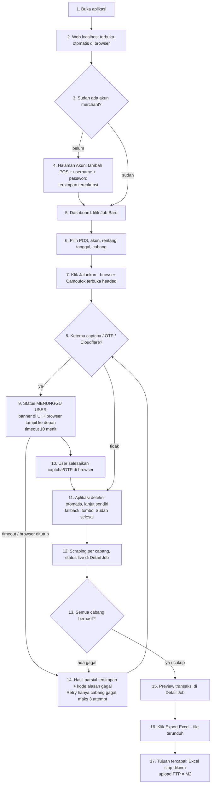
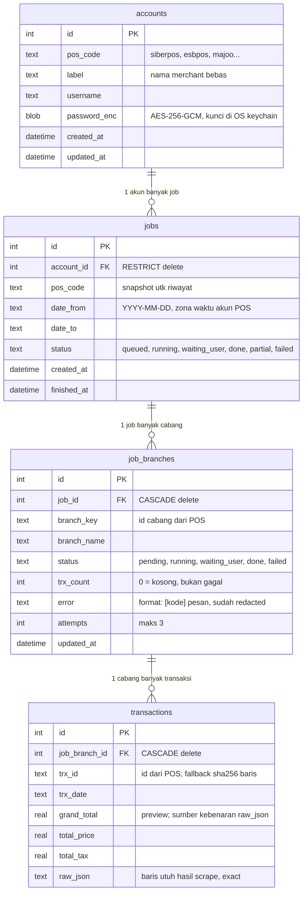

# PRD — Scraping Lokal Otomatis

| | |
|---|---|
| Produk | `scraping-local-auto` — aplikasi web localhost untuk scraping transaksi POS di komputer operator |
| Status | Draft v1 (hasil wawancara 10 pertanyaan + review kritis) |
| Tanggal | 2026-11-18 |
| Owner | Developer pusat (1 orang) |
| Pengguna | 20 operator penarik data transaksi |

---

## 1. Latar Belakang & Masalah

Scraping otomatis sudah berjalan di server melalui dua projek:

| Projek | Stack | Cakupan |
|---|---|---|
| `scraping-efd-python` | Python FastAPI + Camoufox (browser anti-detect) | ~15 POS: SiberPOS, ESB Lite/v2, Casindo, KasirPropos, Majoo, dll |
| `MaphyMerchantApps` | Java Quarkus (HTTP) + Go | ~60+ POS: Accurate, Loyverse, Majoo v2/v4, Nakamura, Trofi, dll |

Server gagal untuk sebagian job karena:

1. **IP server diblok** oleh website POS.
2. **Cloudflare Turnstile / reCAPTCHA** — lolos hanya jika saldo 2captcha cukup; saldo habis = job berhenti (mis. Majoo, Loyverse).

Job yang gagal jatuh ke tim operator sebagai kerja manual: buka browser → login → halaman transaksi → unduh (jika ada fitur) atau **copy-paste satu per satu** → susun Excel → upload FTP ke server. Berjam-jam per job.

Di komputer lokal (IP kantor / hotspot HP) scraping terbukti lancar, dan **ada manusia yang bisa menyelesaikan captcha/OTP** — dua hal yang tidak dimiliki server. Aplikasi ini memindahkan job gagal ke lokal dengan automasi penuh kecuali langkah captcha.

## 2. Tujuan & Non-Goals

### Tujuan

- **Fallback-first:** job yang gagal di server selesai di lokal tanpa copy-paste manual.
- **Cakupan semua POS secara bertahap:** POS yang lancar di server tetap terdaftar di aplikasi sebagai jaga-jaga jika sewaktu-waktu tidak ter-handle server.
- Satu aplikasi yang sama untuk seluruh tim (20 orang), dipasang sekali klik.

### Ukuran sukses

| Metrik | Target |
|---|---|
| Waktu job gagal server → Excel siap kirim | < 10 menit (di luar waktu tunggu user menyelesaikan captcha) |
| Copy-paste manual per job | 0 baris |
| Kredensial merchant tersimpan plaintext | 0 (terenkripsi, tidak bisa diekspor mentah) |
| Job gagal tanpa alasan yang bisa dilaporkan | 0 (setiap kegagalan punya kode + pesan) |

### Non-Goals (eksplisit tidak dikerjakan)

- Tidak menggantikan server scraping; server tetap jalur utama.
- Tidak ada fitur edit/transformasi data transaksi — aplikasi menyalin apa adanya.
- Tidak ada login/akun pengguna aplikasi (1 mesin = 1 operator). Proteksi akses = level OS.
- Tidak ada anti-dobel antar operator (pembagian tugas sudah jelas per orang).
- Tidak ada integrasi daftar job dari server di MVP (job dipilih manual).
- Operator tidak membuat crawler baru; crawler hanya dibuat developer pusat.
- Tidak ada telemetri/analytics; tidak ada data keluar ke pihak ketiga selain website POS target dan (fase M2) server perusahaan.

## 3. Profil Pengguna

### 3.1 Operator Penarik Data (tim, 20 orang)

- **Tugas:** menarik data transaksi merchant dari website POS untuk dilaporkan ke server.
- **Kondisi sekarang:** job gagal server dikerjakan manual berjam-jam (alur di §1).
- **Kemampuan:** semi-teknis — bisa install aplikasi dan mengikuti panduan, tidak bisa debug atau baca stack trace.
- **Lingkungan:** OS campur Windows/Mac/Linux, RAM 16 GB, hak admin bebas, internet kantor stabil + hotspot HP (IP mobile berubah-ubah).
- **Aset:** sudah memegang akun login tiap merchant yang menjadi tanggung jawabnya.
- **Tujuan:** job selesai cepat; jika mentok captcha/OTP cukup selesaikan itu saja, bukan mengulang seluruh alur.

### 3.2 Developer Pusat (owner, 1 orang)

- **Tugas:** membuat & merawat crawler per POS, merilis update, menerima laporan kegagalan manual dari tim.
- **Kondisi sekarang:** mengelola dua codebase server; crawler cepat basi saat website POS berubah.
- **Kemampuan:** developer penuh, dibantu AI; target prototipe v1 dalam 2 hari.
- **Tujuan:** satu aplikasi lokal seragam untuk 20 mesin; update sampai ke semua mesin tanpa distribusi manual; tidak menulis ulang dari nol untuk POS yang sudah punya referensi.

## 4. User Stories

1. Sebagai **operator**, saya ingin **memilih POS, rentang tanggal, dan cabang lalu menjalankan job dari satu tampilan**, supaya **saya tidak perlu login dan menelusuri halaman transaksi manual satu per satu**.
2. Sebagai **operator**, saya ingin **browser muncul otomatis saat scraper bertemu captcha/OTP dan aplikasi melanjutkan sendiri setelah saya menyelesaikannya**, supaya **job yang gagal di server tetap bisa selesai di lokal tanpa saya mengulang seluruh alur**.
3. Sebagai **operator**, saya ingin **hasil yang sudah berhasil tetap tersimpan dan saya bisa retry hanya cabang yang gagal beserta alasan kegagalannya**, supaya **saya tidak mengulang pekerjaan yang sudah jadi dan tahu apa yang harus dilaporkan ke developer**.
4. Sebagai **operator**, saya ingin **data transaksi terunduh sebagai file Excel yang lengkap**, supaya **saya bisa langsung mengirimkannya ke server tanpa menyusun spreadsheet manual dari copy-paste**.
5. Sebagai **operator**, saya ingin **menyimpan akun merchant sekali di aplikasi secara terenkripsi**, supaya **saya tidak mengetik ulang kredensial tiap job dan password tidak berserakan di komputer saya**.
6. Sebagai **operator**, saya ingin **menjadwalkan job berjalan otomatis (mis. tiap pagi menarik data kemarin) di samping tombol jalankan manual**, supaya **data rutin siap tanpa saya harus ingat menjalankannya setiap hari**.
7. Sebagai **operator**, saya ingin **menginstall aplikasi sekali klik yang langsung membuka tampilan web localhost dengan semua runtime sudah terbundel**, supaya **saya yang semi-teknis tidak perlu install Python, browser driver, atau konfigurasi apa pun di OS saya**.
8. Sebagai **developer pusat**, saya ingin **merilis update crawler yang terpasang otomatis di semua aplikasi tim dengan notifikasi reminder**, supaya **perbaikan website POS yang berubah sampai ke 20 komputer tanpa saya mendistribusikan installer satu per satu**.

Pemetaan story → milestone: 1–5 = M0/M1 (wajib), 6 = bagus kalau ada, 7–8 = M2 (rollout tim).

## 5. Cakupan MVP & Milestone

### 5.1 Fitur wajib (maks 5)

| # | Fitur | Alasan |
|---|---|---|
| W1 | **Job runner + UI web localhost** — pilih POS, akun, rentang tanggal, cabang; jalankan; status live | Tanpa ini tidak ada produk; semua fitur lain menggantung di sini |
| W2 | **Mode semi-otomatis** — browser headed, pause saat captcha/OTP, lanjut otomatis setelah user selesai | Pembeda utama vs server; alasan aplikasi lokal ada. Tanpanya ini cuma server versi lemah |
| W3 | **Hasil parsial + retry per cabang + alasan gagal** | Scraping multi-cabang pasti ada yang gagal; tanpa ini satu error menghanguskan seluruh job |
| W4 | **Export Excel lengkap** | Deliverable akhir pengganti kerja manual berjam-jam; scraping sukses tanpa output = tidak berguna |
| W5 | **Kredensial terenkripsi di lokal** | Batas kepercayaan: password merchant di 20 laptop tidak boleh plaintext; juga untuk re-login cepat saat IP hotspot berubah |

### 5.2 Bagus kalau ada (hanya setelah W1–W5 terbukti end-to-end)

- POS pain berikutnya: ESB → Majoo → Loyverse → KasirStaffPOS.
- Penjadwalan job otomatis (story 6).
- Persist sesi/cookie antar-run (mengurangi login ulang).
- Tombol "Salin detail error" (redacted) + riwayat job dengan filter lengkap.

### 5.3 Nanti dulu (di luar MVP)

- Upload FTP otomatis (target FTP belum diketahui).
- Installer desktop 3 OS + runtime ter-bundle (story 7).
- Auto-update + notifikasi reminder (story 8).
- Integrasi daftar job gagal dari server; anti-dobel antar operator; login/PIN aplikasi.

### 5.4 Milestone

| Milestone | Isi | Kriteria keluar |
|---|---|---|
| **M0 — Prototipe dev (2 hari)** | Kerangka lengkap W1–W5 di mesin developer + **1 POS (SiberPOS) end-to-end**; ESB = stretch goal | Satu job SiberPOS nyata dari UI → Excel, skenario captcha tertangani, semua acceptance criteria §13 lulus |
| **M1 — POS pain lengkap** | ESB, Majoo, Loyverse, KasirStaffPOS (crawler baru nol — butuh URL + akun contoh dari tim) | Semua POS pain bisa dijalankan semi-otomatis + export |
| **M2 — Rollout tim** | Installer desktop sekali klik (Win/Mac/Linux, runtime ter-bundle), auto-update bertanda tangan + notifikasi, FTP otomatis, scheduler | 20 operator terpasang tanpa bantuan developer; update tersalurkan otomatis |

> Keputusan kritis: **5 POS rewrite + packaging 3 OS tidak mungkin dalam 2 hari.** M0 memotong cakupan ke 1 POS + kerangka; cakupan pain-POS penuh tetap komitmen produk di M1, bukan dibatalkan.

## 6. Alur Pengguna

Catatan:

- Langkah 6: daftar cabang di-fetch otomatis setelah login pertama; jika POS tidak punya API cabang, user isi manual.
- Job dengan akun yang sama tidak berjalan bersamaan — job kedua berstatus **antri** (lihat §10).
- Tanggal mengikuti zona waktu akun POS; rentang panjang dipecah otomatis oleh crawler sesuai batas POS (mis. 31 hari).

## 7. Halaman, Design System & Isi

4 halaman. Riwayat menyatu di Dashboard (filter status/POS/tanggal).

| Halaman | Route | Isi |
|---|---|---|
| **Dashboard** | `/` | Kartu statistik per status **mengikuti mode tabel** (latest/all) + label mode; daftar **job terbaru per akun** (default) dengan filter status/POS/tanggal + toggle "Tampilkan semua riwayat"; kolom **Trx** (jumlah transaksi) + badge **otomatis** (akun berjadwal aktif); tombol **Job Baru**; baris job klik → Detail Job; banner peringatan |
| **Job Baru** | `/jobs/new` | Pilih POS (default = POS available pertama yang punya akun) → dropdown akun (terfilter POS itu) → rentang tanggal (**prefill sambung job terakhir akun** + preset Kemarin/7 hari/30 hari/Bulan ini/Lanjut job terakhir) → daftar cabang (auto-fetch setelah login, atau input manual; **Pilih semua/Kosongkan**) → tombol **Jalankan** |
| **Detail Job** | `/jobs/:id` | Status live per cabang (antri/running/menunggu user/done/gagal + kode alasan); banner **MENUNGGU USER** + tombol fallback "Sudah selesai"; tombol **Retry cabang gagal**; preview tabel transaksi; tombol **Export Excel** (aktif jika ≥1 cabang done); tombol **Salin detail error** (redacted, untuk lapor manual ke developer) |
| **Akun Merchant** | `/accounts` | Daftar akun dikelompokkan per POS; tambah/edit/hapus; password write-only (tidak pernah ditampilkan ulang); label merchant bebas; hapus akun juga menghapus profil browser terkait |
| **Jadwal Otomatis** | `/schedules` | Halaman sendiri (menu sidebar Konfigurasi): accordion per POS → daftar akun + interval menit (min 1) + toggle Aktif + simpan; rentang menyambung job terakhir akun; hanya saat aplikasi terbuka |

Perilaku live: UI polling status tiap 2 detik (tanpa WebSocket). Sumber kebenaran status = database, bukan memori proses.

### 7.1 Design System — Adminator Enterprise UI v3.1.0

Sumber: `gemini-code-1794991265987.md` (spesifikasi + token) dan `gemini-code-1794991233547.html` (referensi implementasi Data Table & SaaS Admin Shell). Filosofi: **Minimalist Enterprise SaaS** — data densitas tinggi tanpa lelah visual; kanvas abu dingin, kartu putih, batas hairline 1px, bukan bayangan berat. WCAG AA (teks utama 17.4:1, sekunder 4.76:1).

**Token (terkunci dari spesifikasi):**

| Token | Nilai | Pemakaian di app |
|---|---|---|
| primary / hover | `#2563EB` / `#1D4ED8` | CTA utama (Jalankan, Job Baru, Tambah Akun), nav aktif, checkbox terpilih, filter aktif |
| primary-subtle | `#EFF6FF` | Baris tabel terpilih (pilih cabang di Job Baru), badge count filter |
| background / surface | `#F8FAFC` / `#FFFFFF` | Kanvas / kartu, sidebar, header |
| text main / muted / subtle | `#0F172A` / `#64748B` / `#94A3B8` | Judul & isi / sekunder / overline & placeholder |
| border-hairline | `#E2E8F0` | Batas kartu, tabel, input |
| success / bg | `#059669` / `#ECFDF5` | Badge `done` |
| warning / bg | `#D97706` / `#FFFBEB` | Badge `waiting_user` + banner MENUNGGU USER |
| neutral-badge / bg | `#475569` / `#F1F5F9` | Badge `queued`/`pending` |
| **error / bg (ekstensi)** | `#DC2626` / `#FEF2F2` | Badge `failed` — **tidak ada di spesifikasi v3.1.0**; ditambahkan karena app punya status gagal |
| Font | Inter (sans) · JetBrains Mono (mono) | Mono untuk ID job, kode error, `trx_id`; **`tabular-nums` wajib** di tanggal, jumlah transaksi, paginasi |
| Radius & ukuran | card 12px · control 8px · kontrol atomik tinggi 36px (h-9) · baris tabel padding dinamis (py-3.5) | Formula radius konsentris: anak 8px di dalam induk 12px |
| Spacing / shadow | 4/8/16/24/32/48px · shadow-sm `0 1px 2px rgba(15,23,42,0.04)` | Kartu data naik via kontras tonal + hairline |

**Shell (dari referensi HTML):** sidebar 240px (brand h-16 + nav ber-grup dengan label overline; mobile off-canvas + backdrop, desktop statis; **mode mini 72px ikon-saja** via toggle "Ciutkan", persist localStorage) · header h-16 dengan breadcrumb · main max-w-1440 center (px-8 py-7) · page header = overline + h1 28px + deskripsi + tombol aksi. **Scroll hanya di main** (body h-screen overflow-hidden; sidebar & header tetap, konten tidak masuk ke area header).

**Komponen yang dipakai:** kartu data table (toolbar: search h-9 w-72 ber-ikon + select filter h-9 + badge count filter; thead 11px uppercase sortable; tbody 14px divide-y hairline; empty state; footer paginasi h-8 tabular-nums) · badge status (mapping token di atas) · modal max-w-md radius-xl backdrop-blur (form akun, konfirmasi hapus) · banner warning + toast (feedback export/salin) · form (label xs semibold, input/select h-9 radius-8, focus border primary + ring).

**Mapping ke 4 halaman:**

| Halaman | Komponen Adminator |
|---|---|
| Dashboard | Page header + CTA "+ Job Baru"; kartu statistik (ikut mode latest/all) + label mode; kartu data table job: search merchant/POS, filter status + POS; kolom: Job (ID mono + POS + label merchant + badge otomatis), Rentang Tanggal (tabular-nums), Cabang (done/total), **Trx** (tabular-nums), Status (badge), Dibuat, Aksi → Detail; paginasi server-side; empty state |
| Job Baru | Kartu form: select POS → select akun (terfilter) → rentang tanggal + baris preset (Kemarin/7 hari/30 hari/Bulan ini/Lanjut job terakhir) + info job terakhir → daftar cabang checkbox (selected-state `#EFF6FF`) + Pilih semua/Kosongkan; CTA "Jalankan" |
| Detail Job | Header + badge status job + aksi (Export Excel = tombol sekunder ikon download; Retry gagal = primary); banner warning MENUNGGU USER + tombol "Sudah selesai"; kartu tabel cabang (badge status, trx_count tabular-nums, kode error mono, attempts, aksi retry); kartu preview transaksi + paginasi |
| Akun Merchant | Kartu data table (POS, Label, Username, Dibuat, Aksi edit/hapus) + CTA "+ Tambah Akun" → modal form (POS, label, username, password write-only); konfirmasi hapus = modal |
| Jadwal Otomatis | Page header + kartu accordion per POS (`
`): summary nama POS + badge "N akun · M aktif"; isi tabel akun (label + username mono, input interval menit, checkbox Aktif, Terakhir, tombol simpan ikon check); empty state bila belum ada akun |

**Adaptasi wajib dari referensi (bukan salin mentah):**

1. **CDN → lokal (aturan S5).** Referensi memakai Google Fonts + Tailwind v4 browser CDN + Lucide CDN. Di app: Inter & JetBrains Mono (woff2, lisensi OFL) dibundel di `static/fonts/` via `@font-face`; **Tailwind v4 dikompilasi sekali di mesin developer** (`@tailwindcss/cli`, `@theme` token Adminator) → `static/app.css`; Lucide dibundel lokal. **Nol request eksternal saat runtime.** Node/npm hanya di mesin developer — bukan di mesin operator.
2. **Logika tabel: vanilla JS client-side → htmx server-side.** Sort/filter/search/paginasi referensi berjalan di dataset JS; di app semua itu query param + `hx-get` ke FastAPI (data dari SQLite). Pola visual referensi tetap dipertahankan.
3. **Bulk selection (checkbox kolom + bulk bar) tidak masuk MVP** — tidak ada aksi bulk; retry lewat tombol per cabang + "Retry semua gagal". Checkbox di Job Baru = pemilihan cabang, bukan aksi bulk tabel.
4. **Light mode only** sesuai spesifikasi; Pico.css (beserta dark-mode otomatisnya) dibatalkan.
5. Token error ditambahkan (lihat tabel token) — satu-satunya ekstensi palet.

## 8. Arsitektur & Stack (terkunci)

Satu stack baru, monolit, tanpa infrastruktur server:

| Komponen | Pilihan | Alasan |
|---|---|---|
| Bahasa/runtime | Python 3.12 | Referensi crawler existing (SiberPOS, ESB, turnstile) sudah Python; tim developer 1 orang |
| Web/UI | FastAPI + **Jinja2** (HTML server-rendered) + **htmx** (1 file JS lokal) + **Tailwind v4 build lokal** dengan token **Adminator Enterprise UI v3.1.0** (§7.1) + Inter/JetBrains Mono/Lucide dibundel lokal + `StaticFiles` | Design system terkunci dari referensi owner; tanpa Node/SPA/CDN di mesin operator — sesuai S5 |
| Database | SQLite (mode WAL), satu file di direktori data aplikasi | Lokal, tanpa server DB; WAL untuk baca saat tulis |
| Browser automation | Camoufox (Playwright sync API) dijalankan di thread executor | Anti-detect terbukti di projek lama; sync API tidak memblokir event loop FastAPI |
| Job runner | asyncio task in-process, state di DB | Tanpa Redis/queue eksternal — beban 1 operator, maks 2 job paralel |
| Enkripsi kredensial | AES-256-GCM (`cryptography`), kunci 32-byte di OS keychain (`keyring`) | Windows Credential Manager / macOS Keychain / libsecret; fallback keyfile `0600` + warning jika keychain tidak ada |
| Excel | xlsxwriter mode `constant_memory`, tulis streaming per batch dari DB | Export 100rb baris tanpa memuat semua ke RAM |
| Distribusi M0 | Jalankan dari source di mesin developer (`python -m app`), browser terbuka otomatis | Installer desktop = M2 |
| Distribusi M2 | Wrapper desktop (Tauri atau PyInstaller+webview — diputuskan saat M2) + auto-update HTTPS bertanda tangan | Story 7–8 |

Aturan keras arsitektur:

- Server web **bind hanya `127.0.0.1`** — tidak pernah `0.0.0.0`.
- Semua request pengubah state (POST/PUT/DELETE) wajib **CSRF token**; validasi header `Host`/`Origin` = loopback (anti DNS-rebinding).
- Browser **headed di dev** (`python -m app`, operator menyelesaikan captcha); **headless di build
  produksi/exe** (`SLA_HEADLESS=1` di sidecar + Electron) — tanpa jendela browser. Gate interaktif yang
  tak lolos sendiri di headless → `waiting_user` lalu `[user_timeout]`; retry via UI.
- Maks **2 job berjalan bersamaan** (RAM 16 GB, ~1–2 GB per Camoufox); job dengan **akun sama diserialkan** (status antri).
- Maks **2 auto re-login per cabang** dan **3 attempt total per cabang** — mencegah loop tak berujung dan lockout akun merchant.
- Logika crawler **ditulis ulang mencontoh referensi** (`siberpos_crawler.py`, `esb_posv2.py`, `turnstile_login.py` di `scraping-efd-python`) — bukan mem-port infrastruktur server (Redis, SSH tunnel, pool).
- Direktori data aplikasi (DB, profil browser, export): permission user-only (`0700`).

## 9. Rancangan Database

SQLite. 4 tabel — tanpa tabel sessions/exports/users/schedules (persist cookie & jadwal = bagus kalau ada; export = file di disk; auth = tidak perlu; registry POS hidup di kode crawler).

Aturan data:

- **UNIQUE(`account_id`, `trx_id`)** + upsert → dedup **per akun lintas job**: transaksi sudah ada & identik di-skip; isi berubah di-update di tempat dan pindah ke cabang run terbaru (versi terbaru menang). Retry dalam cabang tetap tidak mendobel. Run berulang (scheduler interval) tidak menumpuk salinan; export per job jadi inkremental. Jika POS tidak punya id stabil, `trx_id` = sha256 dari baris ternormalisasi. Migrasi DB lama otomatis (backfill `account_id`, buang duplikat pertahankan versi terbaru).
- **`raw_json` = sumber kebenaran** (format Excel fleksibel, presisi uang exact). Kolom `real` hanya untuk preview/sorting; Excel dirender dari `raw_json`.
- Commit **per cabang** (bukan per job) → crash tidak menghilangkan cabang yang sudah selesai.
- Hapus akun: **RESTRICT** jika masih punya job; hapus job: **CASCADE** ke branches + transactions; hapus akun juga menghapus direktori profil browsernya.
- **Retensi:** job berumur > 90 hari dihapus otomatis saat startup (cascade). Akun tidak pernah dihapus otomatis.
- Kode error baku: `auth` (kredensial ditolak/ubah password), `user_timeout` (captcha tidak diselesaikan ≤10 menit), `browser` (ditutup user/crash), `network`, `ui_changed` (selector tidak ditemukan — lapor developer), `interrupted` (aplikasi tertutup saat job jalan), `unknown`.

## 10. Edge Cases & Penanganan

| # | Kasus | Perilaku yang dikunci |
|---|---|---|
| E1 | User pergi/tidak menyelesaikan captcha | Timeout 10 menit → cabang `failed [user_timeout]`, job lanjut ke cabang lain; cabang bisa di-retry |
| E2 | User menutup browser headed mid-job | Deteksi driver mati → cabang `failed [browser]`, retryable; bukan crash aplikasi |
| E3 | Sesi putus mid-scrape (IP hotspot berubah) | Auto re-login maks 2× per cabang; jika captcha muncul lagi → alur menunggu user; attempt ke-3 gagal → berhenti, bukan loop |
| E4 | Kredensial ditolak website (password berubah) | Cabang `failed [auth]` **tanpa retry otomatis** (mencegah lockout akun merchant); UI arahkan edit akun |
| E5 | Aplikasi crash / laptop tidur mid-job | Startup recovery: job/cabang berstatus `running`/`waiting_user` → `failed [interrupted]`; data cabang yang sudah commit tetap utuh; retryable |
| E6 | Dua job untuk akun sama | Job kedua `queued` sampai job pertama selesai (kebijakan single-session POS); UI menampilkan "antri — akun sedang dipakai" |
| E7 | Lebih dari 2 job bersamaan | Job ke-3+ `queued` (batas RAM); antrian in-process, hilang saat restart → E5 menandainya |
| E8 | Tidak ada transaksi di rentang tanggal | Cabang `done` dengan `trx_count=0`, label "kosong"; Excel tetap dibuat (header saja) — kosong ≠ gagal |
| E9 | POS membatasi rentang tanggal (mis. maks 31 hari) | Crawler memecah rentang jadi chunk otomatis; transparan bagi user; dedup antar-chunk via UNIQUE |
| E10 | Transaksi baru masuk saat scraping berjalan (paginasi bergeser) | Dedup `trx_id`; urutan scrape stabil (tertua dulu); selisih kecil diterima, job ulang menangkap sisanya |
| E11 | POS tanpa id transaksi stabil | `trx_id` = sha256 baris ternormalisasi (lihat §9) |
| E12 | Export diklik saat job masih jalan | Tombol aktif hanya jika ≥1 cabang `done`; export ulang = file sama (idempotent); nama file `{pos}_{label}_{from}_{to}_{jobid}.xlsx` |
| E13 | Export sangat besar (≥100rb baris) | Streaming writer + baca DB per batch; tidak memuat semua ke RAM |
| E14 | Daftar cabang gagal di-fetch padahal login sukses | Fallback input cabang manual di Job Baru / Detail Job |
| E15 | Website POS berubah UI | `failed [ui_changed]` + pesan menyebut elemen yang hilang; tombol Salin detail error (redacted) untuk lapor ke developer |
| E16 | Keychain Linux tidak tersedia (distro minimal) | Fallback keyfile permission `0600` + banner peringatan di Dashboard; aplikasi tetap jalan |
| E17 | Akun dihapus saat ada job berjalan | RESTRICT — hapus ditolak sampai job selesai/dihapus |
| E18 | DB membengkak (job harian × 20 mesin) | Retensi 90 hari otomatis saat startup (§9) |

## 11. Keamanan & Privasi

### Ancaman → mitigasi

| # | Ancaman | Mitigasi (wajib di MVP kecuali ditandai M2) |
|---|---|---|
| S1 | Operator lain di LAN kantor/hotspot mengakses aplikasi (tanpa auth sesuai keputusan) | Bind **hanya 127.0.0.1**; validasi `Host`/`Origin` loopback (anti DNS-rebinding); **CSRF token** di semua request pengubah state — webpage jahat tidak bisa memicu job/membaca data via browser user |
| S2 | Password merchant bocor lewat log/error/screenshot | **Redaction wajib**: field password, header Cookie/Authorization, query param token/key tidak pernah masuk log, pesan error, atau teks "Salin detail error". Tidak ada screenshot otomatis full-page. Password write-only di UI |
| S3 | Kredensial tersimpan plaintext di disk | AES-256-GCM; kunci di OS keychain (bukan di DB/file config); fallback keyfile `0600` hanya jika keychain absen (E16) |
| S4 | Laptop hilang/dicuri → data transaksi (mengandung PII pelanggan: nama, telepon) terbaca | Direktori data `0700`; rekomendasi disk encryption OS (BitLocker/FileVault/LUKS) di panduan install M2; **risiko residual diakui**: SQLite tidak dienkripsi at-rest (SQLCipher ditimbang ulang saat M2) |
| S5 | Kredensial terkirim ke pihak selain POS pemiliknya | Aturan kode: kredensial hanya di-submit ke domain POS milik akun itu; tidak ada telemetri/analytics/CDN eksternal; seluruh aset UI lokal — **font, CSS Tailwind hasil build, dan ikon Lucide dibundel** (referensi desain memakai CDN; wajib dilokalkan, §7.1 adaptasi 1) |
| S6 | Sesi/cookie merchant tertinggal setelah akun dihapus | Hapus akun → hapus direktori profil browser Camoufox terkait |
| S7 | Lockout akun merchant akibat retry brute-force | E4: `auth` gagal tanpa auto-retry; batas 2 re-login / 3 attempt per cabang |
| S8 | Update palsu/mitM saat auto-update (M2) | HTTPS wajib + verifikasi tanda tangan/checksum paket update; notifikasi reminder sebelum terap |
| S9 | File Excel berisi data merchant tersebar | Export ke folder unduhan user; aplikasi tidak mengunggah ke mana pun di MVP; FTP (M2) hanya ke endpoint server perusahaan yang dikonfirmasi owner |

### Prinsip privasi

- Data transaksi = milik merchant; disimpan **hanya lokal**, dikirim hanya ke server perusahaan (M2, via FTP yang dikonfirmasi).
- Tidak ada pengumpulan data operator, tidak ada crash-report otomatis (lapor gagal = manual, sesuai keputusan wawancara).
- Error yang bisa disalin user sudah melalui redaction S2 — aman diteruskan ke developer via chat.

## 12. Keputusan Terkunci & Pertanyaan Terbuka

### Ambiguitas yang sudah diresolve (hasil review kritis)

| Ambiguitas sebelumnya | Keputusan |
|---|---|
| "v1 semua POS pain (5)" vs "2 hari" vs "rewrite total" | Milestone M0/M1/M2 (§5.4): 2 hari = kerangka + SiberPOS end-to-end; 5 POS pain = M1; packaging/auto-update/FTP = M2 |
| "Satu stack baru" tidak disebut stack-nya | Python monolit: FastAPI + SQLite + Camoufox (§8) |
| POS pertama tidak ditentukan | **SiberPOS** (referensi Playwright ada), ESB stretch; KasirStaffPOS terakhir (crawler baru nol, tanpa referensi di kedua codebase — sudah diverifikasi grep) |
| "Tanpa login" vs server web terbuka | Tanpa auth aplikasi, tapi S1 wajib: loopback-only + CSRF + Host check (batas kepercayaan, bukan fitur auth) |
| Excel "format fleksibel" — konsumen tidak dilibatkan | MVP: kolom standar (trx_id, tanggal, cabang, total) + flatten `raw_json`; konfirmasi kolom final ke tim server = pertanyaan terbuka Q1 |
| `waiting_user` tanpa batas waktu | Timeout 10 menit → gagal per cabang, job lanjut (E1) |
| Retry tanpa batas | Maks 3 attempt, 2 auto re-login; `auth` tidak di-retry (E3/E4/S7) |
| Status job menggantung setelah crash | Startup recovery (E5) |
| Dedup saat POS tanpa id stabil | Fallback sha256 (E11) |
| Kosong vs gagal | `done` + `trx_count=0` = kosong (E8) |
| Zona waktu & batas rentang tanggal | Tanggal = zona waktu akun POS; chunking otomatis (E9) |
| Data menumpuk selamanya | Retensi 90 hari (E18) |
| Keychain Linux absen | Fallback keyfile + warning (E16) |
| UI visual: Pico.css classless (keputusan awal) | **Diganti Adminator Enterprise UI v3.1.0** sesuai referensi owner (`gemini-code-1794991265987.md` + `.html`); Tailwind v4 build lokal, font/ikon dibundel, light-only, token error ditambahkan (§7.1) |

### Pertanyaan terbuka (tidak memblokir M0)

| # | Pertanyaan | Ditanyakan ke | Blocking |
|---|---|---|---|
| Q1 | Kolom/format Excel final yang diterima server | Tim server | M2 (FTP) |
| Q2 | Target FTP: host, folder, kredensial | Owner/tim server | M2 |
| Q3 | KasirStaffPOS: URL website + akun contoh | Tim operator | M1 |
| Q4 | Teknologi wrapper desktop (kandidat kuat: Electron membungkus UI localhost; alternatif Tauri/PyInstaller+webview) | Developer | M2 |
| Q5 | Spesifikasi jadwal (jam, timezone, hari) | Owner | Fitur scheduler |
| Q6 | Batas rentang tanggal per POS | Ditemukan saat build crawler | M1 per POS |

### Keputusan owner tambahan (setelah M0)

- **2026-11-19 — skip T20, lanjut T22+:** owner menyatakan 4 POS sudah bisa mengambil data
  (SiberPOS, ESB, Majoo, Loyverse — T10/T15/T18/T19) dan menginstruksikan **T20 (KasirStaffPOS)
  dilewati sementara** (Q3: URL + akun contoh belum ada dari tim); dikerjakan bila Q3 terjawab
  dan owner minta dilanjutkan. Task berikutnya (T22 scheduler, dst.) dikerjakan mulai hari ini.
- **2026-11-19 — Q5 dijawab dengan default developer** (owner instruksi "lanjutkan T22" tanpa
  spesifikasi): jadwal **harian pukul 06:00 waktu lokal mesin**, rentang = **kemarin (D-1)**,
  semua hari; per akun bisa diubah jamnya / dinonaktifkan dari halaman Akun; override manual =
  Job Baru tetap ada. Zona waktu = lokal mesin (operator ID ≈ zona akun POS). Owner dapat
  mengubah default ini kapan saja lewat konfigurasi per akun.
- **2026-11-19 — Q4 terjawab: Electron** (keputusan owner via form): wrapper desktop membungkus
  UI localhost yang ada; sidecar Python + Camoufox terbundel dalam installer. **Cakupan bukti:
  Win-first** — installer Windows dibangun + diuji end-to-end di mesin developer sekarang;
  build Mac/Linux menyusul saat mesin uji tersedia (acceptance M2 "3 OS tanpa bantuan developer"
  belum terobservasi sampai saat itu). Q1/Q2 (kolom Excel final + target FTP) belum ada dari
  tim server → T26 tetap blocked.
- **2026-11-19 — T28 evaluasi SQLCipher: GO (adopsi saat rollout M2).** Bukti empiris mesin ini
  (Python 3.9 Win): wheel `sqlcipher3==0.6.5` (cp39-win_amd64, SQLite 3.54.1) terpasang bersih;
  `PRAGMA journal_mode=WAL` jalan terenkripsi; baca tanpa kunci ditolak (DatabaseError);
  header file bukan `SQLite format 3` dan nol bocoran plaintext baris; overhead micro-bench
  2000 insert tidak signifikan (4 ms vs 5 ms sqlite3). Kunci tetap master key OS keychain (S3).
  Implementasi + migrasi DB plaintext→terenkripsi (`sqlcipher_export`) dijadwalkan bersama
  rollout M2 karena DB operator sudah berisi data; wheel Mac/Linux diverifikasi saat build M2.
  Sampai adopsi M2, residual S4 tetap: rekomendasi disk encryption OS (BitLocker/FileVault/LUKS).
  `pysqlcipher3` = sdist saja (beban kompilasi) → tidak dipilih.
- **2026-11-23 — Q5 direvisi owner: jadwal v2 interval menit + grup POS.** Menggantikan default
  harian 06:00/D-1: jadwal kini **interval menit per akun (min 1, default 60)**, UI accordion
  per POS (klik POS → daftar akun), rentang **kemarin–hari ini (D-1..D0)**, **hanya saat aplikasi
  terbuka** (tanpa backfill; catch-up sekali saat dibuka). Pengaman: skip akun busy (antrian tidak
  menumpuk), tahan bila job terakhir gagal `[auth]` sampai retry/manual (cegah lockout), purge
  retensi 90 hari harian oleh scheduler. Migrasi DB lama otomatis (jadwal harian aktif → interval
  1440). Bukti: self-check `python -m app.scheduler`, migrasi DB lama, HTTP save (422/200 + open_pos),
  tick live membuat job demo & siberpos pada kadensi 1 menit, verifikasi visual accordion browser.
- **2026-11-23 — dedup transaksi per akun + dashboard job terbaru.** Owner: run berulang (tanggal
  sama/beda) menumpuk data duplikat (terukur 40% baris duplikat di DB). Keputusan: kunci dedup
  dinaikkan `UNIQUE(job_branch_id,trx_id)` → `UNIQUE(account_id,trx_id)`; trx identik di-skip, isi
  berubah update di tempat + pindah ke run terbaru (bukan hapus-lalu-ganti — hindari data loss saat
  scrape parsial). Dashboard default menampilkan **job terbaru per akun** + toggle semua riwayat.
  Migrasi DB lama otomatis (backfill account_id, buang duplikat versi terbaru menang). Bukti:
  acceptance 37/37 PASS, proof migrasi/dedup/update/retry/export inkremental, visual toggle browser.
- **2026-11-23 — rentang jadwal menyambung job terakhir.** Owner: jadwal otomatis selalu menarik
  tanggal yang sama (22..23); seharusnya maju mengikuti job terakhir. Keputusan: scheduler memakai
  `db.last_job_range(account_id)` — job baru mulai H+1 setelah `date_to` job terakhir sampai hari ini
  (job pertama akun = kemarin..hari ini; bila sudah mencakup hari ini, rentang diulang/refresh).
  Bukti: self-check 4 kasus rentang + live tick (job terakhir 10..15 → job baru 16..hari ini).
- **2026-11-23 — UX dashboard + Job Baru (6 perbaikan).** Owner: UI membingungkan. Keputusan:
  (1) kartu statistik ikut mode tabel latest/all + label mode (konsisten, tak lagi hitung semua job
  saat tabel latest); (2) kolom Trx di tabel job; (3) badge "otomatis" utk akun berjadwal aktif;
  (4) preset tanggal (Kemarin/7 hari/30 hari/Bulan ini/Lanjut job terakhir) + prefill sambung job
  terakhir saat akun dipilih (endpoint `/partials/job-dates`); (5) Pilih semua/Kosongkan cabang;
  (6) POS default = available pertama yang punya akun (bukan selalu demo). Bukti: visual browser
  (stats 4↔17 ikut toggle, kolom Trx 960, badge otomatis, prefill akun 3 → 23..23 + info job terakhir,
  preset 7d 17..23, select-all 3 cabang bertahan setelah htmx swap) + acceptance suite.
- **2026-11-23 — Jadwal Otomatis jadi halaman sendiri.** Owner: lebih baik terpisah dari Akun
  Merchant. Keputusan: route `/schedules` + `templates/schedules.html` (page header + include
  `_schedules.html`); kartu jadwal dihapus dari `accounts.html`; item nav sidebar "Jadwal Otomatis"
  (grup Konfigurasi, ikon calendar-clock, active_page=schedules). POST schedule tetap di
  `/accounts/{id}/schedule` (hx-target #schedules-card, tetap di halaman /schedules). Bukti visual:
  nav aktif, 4 grup POS, simpan jadwal persists (DB enabled=1 interval=5), badge "1 aktif",
  accounts bersih dari kartu jadwal.
- **2026-11-23 — shell layout: sidebar mini + scroll hanya main.** Owner: sidebar bisa diciutkan
  (mode mini), sidebar & header tidak ikut scroll, konten tidak masuk area navbar. Keputusan:
  body `h-screen overflow-hidden`; sidebar & header statis di flex row; hanya `<main>` yang
  `overflow-y-auto` (header bukan sticky lagi — tetap karena main yang scroll). Mode mini 72px
  ikon-saja: kelas `.sidebar-mini` (label disembunyikan, ikon center, tooltip title), toggle
  "Ciutkan" di footer sidebar, persist `localStorage sla-sidebar-mini`. Mobile off-canvas tetap.
  Bukti visual: main scroll 500px → header/sidebar top=0, window.scrollY=0; mini 240→72px label
  hidden ikon 16px, reload persist, expand kembali; mobile drawer buka/tutup normal.
- **2026-11-23 — jadwal memakai cabang job terakhir.** Owner: jadwal otomatis mengambil semua
  cabang padahal Job Baru hanya single branch. Penyebab: scheduler `create_job(..., [])` → runner
  auto-fetch semua cabang. Keputusan: `db.last_job_branches(account_id)` (cabang job terbaru) →
  scheduler memakai ulang pilihan cabang job terakhir; akun belum punya job → `[]` (auto-fetch).
  Bukti: self-check kasus cabang tunggal + live tick (job terakhir demo-pusat → job scheduler
  hanya ['demo-pusat'], bukan semua).
- **2026-11-25 — portabilitas Mac disiapkan (build tetap Win-first).** Owner tanya cara install
  Mac. Keputusan: kode dibuat portabel — `browser.py` resolusi executable Camoufox per OS
  (win `camoufox.exe`, mac `Camoufox.app/Contents/MacOS/camoufox` + version.json di Resources,
  lin `camoufox-bin`); `main.js` nama sidecar per `process.platform`; `build_sidecar.py` separator
  `--add-data` (`;` win / `:` unix) + keyring backend per OS; `package.json` target mac dmg/zip +
  `npm run dist:mac`. **Binary Mac wajib dibangun di Mac/CI macOS** (PyInstaller tak cross-compile);
  belum diuji di Mac nyata. Bukti Windows tak regresi: rebuild sidecar + launch Camoufox bundle OK.
- **2026-11-25 — CI build Mac ditambahkan.** `.github/workflows/build-mac.yml`: runner macos-latest
  (Python 3.12, Node 22), trigger workflow_dispatch / tag v*; langkah fetch Camoufox → vendor →
  build sidecar → smoke healthz → dist:mac → artifact dmg+zip. Memungkinkan build Mac tanpa mesin
  fisik. YAML tervalidasi; eksekusi CI nyata belum dijalankan (perlu push ke GitHub).

## 13. Acceptance Criteria (observable, per fitur wajib)

**W1 — Job runner + UI**
- Buat job SiberPOS (akun + tanggal + cabang) dari `/jobs/new` → status berpindah `queued → running → done/partial` terlihat di Dashboard & Detail Job tanpa reload manual.
- Job kedua dengan akun sama berstatus antri sampai job pertama selesai (E6).
- Restart aplikasi saat job jalan → job jadi `failed [interrupted]`, bukan menggantung (E5).

**W2 — Semi-otomatis**
- Saat gate captcha/Cloudflare terdeteksi: browser tampil ke depan, cabang `waiting_user`, banner muncul di UI.
- User menyelesaikan captcha → aplikasi lanjut **tanpa klik apa pun** dalam ≤5 detik (polling deteksi); tombol "Sudah selesai" berfungsi sebagai fallback.
- Dibiarkan 10 menit → cabang `failed [user_timeout]`, cabang lain tetap jalan (E1).

**W3 — Parsial + retry**
- Job 2 cabang, 1 gagal → data cabang sukses utuh di DB; tombol retry hanya menjalankan cabang gagal.
- Retry tidak menambah baris duplikat (bukti: count transaksi sebelum = sesudah untuk data yang sama).
- Setiap kegagalan menampilkan kode + pesan yang bisa disalin (redacted).

**W4 — Excel**
- Export job partial → file terbuka di Excel/LibreOffice; jumlah baris = jumlah transaksi di DB; nilai uang cocok dengan `raw_json` (bukan hasil pembulatan kolom REAL).
- Job kosong → file berisi header (E8). Export ulang → file identik (E12).

**W5 — Kredensial**
- Inspeksi file SQLite: tidak ada string password plaintext di tabel mana pun.
- Restart aplikasi → job berjalan tanpa input ulang kredensial.
- Hapus akun → baris hilang + direktori profil browser hilang; hapus akun ber-job ditolak (E17).

**Keamanan (lintas fitur)**
- Request dari IP non-loopback ditolak/tidak terjangkau (bind 127.0.0.1).
- POST tanpa CSRF token → 403; header `Host` non-loopback → 403.
- Pesan error/log dari kegagalan login tidak memuat password maupun token (uji dengan kredensial salah + halaman ber-token).
- **Nol request eksternal saat runtime** (DevTools Network: hanya `127.0.0.1` — font/CSS/ikon semua lokal, adaptasi S5).
- UI mengikuti token §7.1: badge status sesuai palet, `tabular-nums` di kolom angka/tanggal, radius card 12px/control 8px, kontrol h-9.

## 14. Rencana M0 (2 hari) & Risiko

### Rencana

| Hari | Kerja | Bukti selesai |
|---|---|---|
| **1** | Kerangka FastAPI + SQLite + 4 halaman; enkripsi kredensial + keychain; job runner (antrian, lock per akun, cap 2); crawler SiberPOS (contoh `siberpos_crawler.py`) happy path; **buktikan pause/resume captcha paling awal** (W2 = bagian paling tricky) | Job SiberPOS nyata jalan dari UI; skenario captcha pause→resume terbukti |
| **2** | Hardening W2 (timeout, fallback, deteksi browser mati); parsial + retry + dedup; export Excel streaming; startup recovery; redaction + CSRF/Host; acceptance criteria §13 dijalankan | Semua acceptance W1–W5 + keamanan lulus; ESB = stretch jika waktu sisa |

### Risiko utama

| Risiko | Dampak | Mitigasi |
|---|---|---|
| Pause/resume di sekitar captcha/OTP ternyata rapuh (perilaku berbeda per POS) | W2 tersandera → seluruh MVP gagal | Buktikan hari-1 di SiberPOS; referensi `turnstile_login.py` sudah ada; fallback tombol manual |
| Ekspektasi 5 POS dalam 2 hari | Kualitas dikorbankan, semua setengah jadi | M0 dikunci 1 POS + kerangka (§5.4); komunikasi ke owner sudah dilakukan |
| Website POS berubah saat development | Crawler baru langsung basi | Kode error `ui_changed` + referensi crawler lama sebagai pembanding |
| KasirStaffPOS tanpa referensi sama sekali | Estimasi M1 meleset | Q3 (URL + akun contoh) dikumpulkan sebelum M1 dimulai |
| SQLite tanpa enkripsi at-rest | S4 residual | Diakui eksplisit; disk encryption OS di panduan M2; evaluasi SQLCipher saat M2 |

---

*Dokumen ini adalah satu-satunya sumber kebenaran produk. Perubahan cakupan wajib lewat keputusan owner yang dicatat di §12.*
